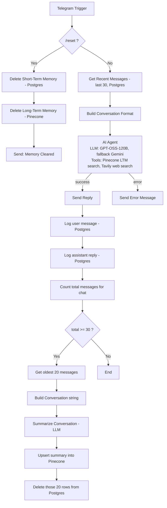

# Long Term Memory AI Agent With Web Search Tool

A Telegram AI assistant with two memory layers: short-term conversation history in PostgreSQL and persistent long-term memory in Pinecone. The agent prefers recent context and only queries long-term memory when the user explicitly refers to something past. Tavily is available as a live web-search tool. When short-term history hits 30 messages, the oldest 20 are summarized and archived into Pinecone, then purged from Postgres.

## What it does

1. `/reset` wipes both memory layers for that chat and confirms.
2. Any other message: the last 30 short-term messages are pulled from Postgres and formatted as conversation context.
3. An AI Agent answers using that context first, calling the **Get Long Term Memory** tool (Pinecone semantic search, filtered by `chat_id`) only when the user references past conversations, and the **Tavily** tool only for live/current information.
4. The reply is sent, then both the user's message and the assistant's reply are logged to Postgres.
5. If the short-term table now holds ≥30 messages for that chat, the oldest 20 are pulled, summarized by an LLM into a dense episodic summary, upserted into Pinecone, and deleted from Postgres — keeping active context lightweight.

## Flow diagram




## Tech stack

| Component | Role |
|---|---|
| n8n | Orchestration |
| Telegram Bot API | Trigger + replies |
| PostgreSQL | Short-term (rolling) conversation memory |
| Pinecone | Long-term (semantic, persistent) memory store |
| Groq (`openai/gpt-oss-120b`, `openai/gpt-oss-20b`) | Agent primary LLM + summarizer LLM |
| Google Gemini | Agent fallback LLM |
| Tavily Search API | Live web search tool for the agent |

## Prerequisites

- n8n with LangChain, Postgres, and Tavily nodes.
- A Telegram bot token.
- A Groq API key, a Google AI Studio (Gemini) API key, a Tavily API key.
- A Pinecone index with an **integrated inference model** (the workflow calls `/records/.../search` and `/records/.../upsert` with `inputs.text`, i.e. Pinecone's hosted-embedding record API, not raw vector upsert).
- A PostgreSQL database.

## Required Postgres schema

The workflow reads/writes a table called `recent_memory_of_LTM_agent`. It isn't created by the workflow — you need to create it yourself, matching the columns actually used (`id`, `chat_id`, `role`, `message`):

```sql
CREATE TABLE recent_memory_of_LTM_agent (
    id SERIAL PRIMARY KEY,
    chat_id BIGINT NOT NULL,
    role TEXT NOT NULL,
    message TEXT NOT NULL,
    created_at TIMESTAMPTZ DEFAULT now()
);
```

## Setup

1. Import `Long_Term_Memory_AI_Agent_With_Web_Search_Tool.json` into n8n.
2. Create the Postgres table above.
3. Create a Pinecone index (with integrated embeddings) and update the hardcoded host URL in **every** HTTP Request node that calls Pinecone (`Delete Long Term Memory`, `Get Long Term Memory`, `Upsert Into Long Term Memory`) — they currently point at a personal index host and will need to be replaced with your own.
4. Attach credentials:
   - `telegramApi` → **Trigger**, **Send Message About Memory Deletion**, **Send Reply**, **Send Error Message**
   - `postgres` → all Postgres nodes
   - `pineconeApi` → all Pinecone HTTP Request nodes
   - `groqApi` → **GPT-OSS-120B**, **GPT-OSS-20B**
   - `googlePalmApi` → **FLASH-3**
   - `tavilyApi` → **Tavily** tool node
5. Activate and test with a few messages, then check the summarization path by sending 30+ messages (or lowering the `>= 30` threshold temporarily in **Check Recent Messages Limit** to test faster).


## Notes & Limitations

- Short-term memory is limited to the most recent 30 messages per chat.
- Long-term memory depends on LLM-generated summaries, so some details from older conversations may be compressed or omitted.
- Tavily is used only when the user asks for current or web-based information; general questions are handled without web search.
- `/reset` permanently clears both short-term PostgreSQL memory and long-term Pinecone memory for that chat.
